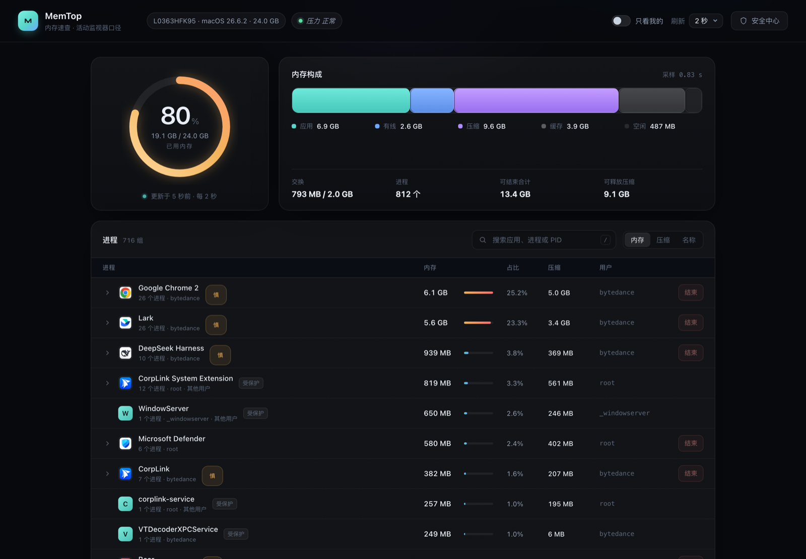
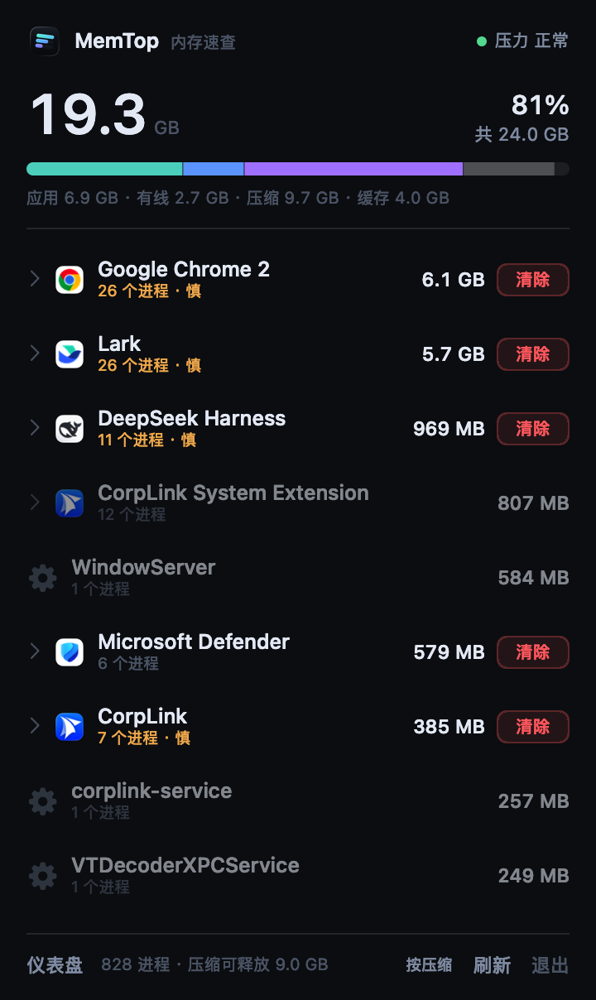
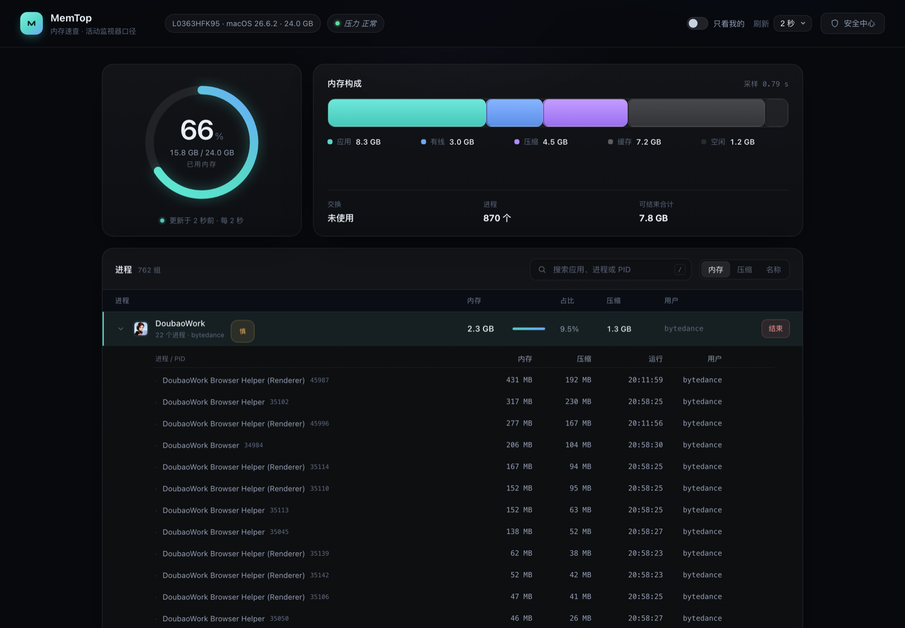
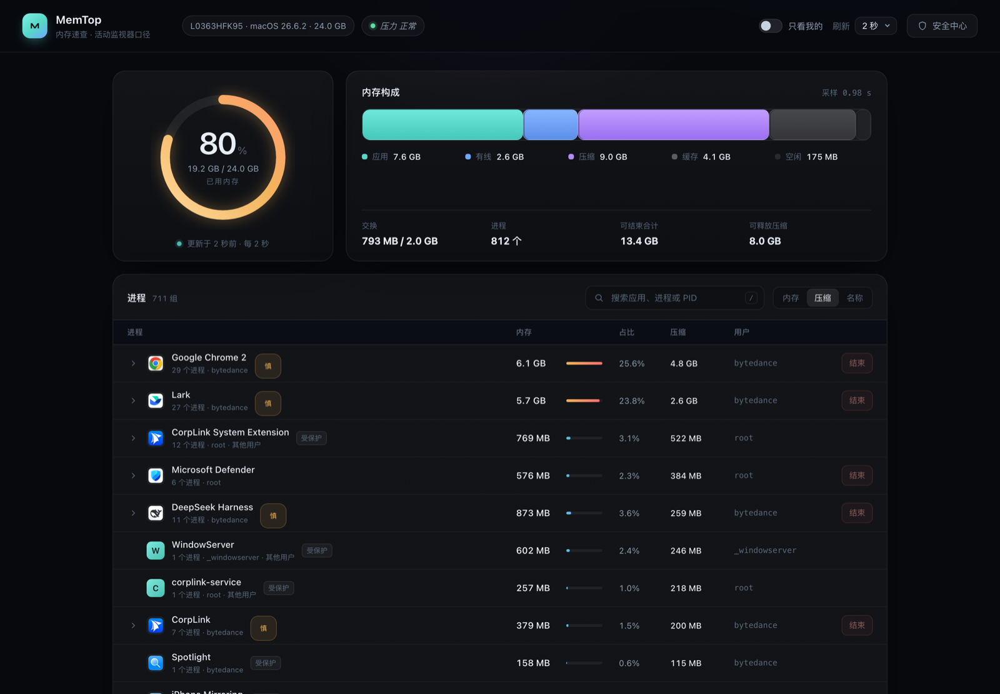

# MemTop

<p align="center">
  
</p>

<p align="center">
  <b>macOS 内存速查 · 按应用归组 · 安全结束非必要进程</b><br>
  一个内核，三种形态：命令行 / TUI、本地 Web 仪表盘、菜单栏 App
</p>

<p align="center">
  
  
  
  
</p>



## 为什么不是 `ps` 的 RSS

活动监视器「内存」列显示的是 **phys_footprint（物理足迹）**，包含被压缩的内存；
`ps` 的 RSS 只算常驻页，压缩过的部分完全看不到。一个吃满内存的浏览器，在 `ps` 里可能只有
几百 MB，在活动监视器里却是几个 GB。

MemTop 统一用 `top` 的 MEM 列（同为 phys_footprint），并用 `proc_pidpath` 拿到精确可执行
路径（对 root 进程同样有效，不需要 sudo），再按 `.app` 归属把 helper / renderer 归到同一个
应用下——和活动监视器的分组视图一致。

## 三种形态

| | 命令行 / TUI | Web 仪表盘 | 菜单栏 App |
| --- | --- | --- | --- |
| 入口 | `memtop` | `memtop web` | `MemTopBar.app` |
| 适合 | 脚本、SSH、快速查看 | 大屏分析、搜索、批量处理 | 随手瞄一眼、快速结束 |
| 依赖 | Python 3.9+ | Python 标准库 | 已编译，无运行时依赖 |
| 代码 | `memtop/memtop.py` | `memtop/web/` | `memtop-bar/main.swift` |

### 菜单栏 App



- 菜单栏常驻 `76% 18.2G`，点开是 360×604 面板；
- 按应用分组、从高到低排序，行尾「清除」一步结束整个应用；
- 展开后勾选子进程，底部「结束选中」批量结束；
- 结束动作走同一套 `memtop kill`，保护规则和审计日志与命令行完全一致。

### Web 仪表盘



- 环形已用占比 + 内存构成条（应用 / 有线 / 压缩 / 缓存 / 空闲）；
- 应用列表支持展开、搜索、按内存 / 压缩 / 名称排序、「只看我的」；
- 结束确认弹窗、保护名单、操作记录；
- 只监听 `127.0.0.1`，写操作需要一次性会话 token。

## 安装

```bash
git clone https://github.com/Dacong0304/memtop.git
cd memtop
./install.sh          # 安装命令行 + Web 前端，并编译安装菜单栏 App
```

只装其中一个：

```bash
cd memtop && ./install.sh       # 命令行 / TUI + Web
cd memtop-bar && ./install.sh   # 菜单栏 App（需要 Command Line Tools）
```

菜单栏 App 也可以直接从 [Releases](https://github.com/Dacong0304/memtop/releases)
下载 `MemTopBar-1.2.0.zip`，解压后拖进 `~/Applications`。

## 用法

```bash
memtop                      # TUI 交互界面
memtop -1 --limit 15        # 打印一次快照
memtop pressure             # 只看内存概况
memtop --json               # 机器可读输出

memtop web                  # 浏览器仪表盘（自动打开 127.0.0.1:8787）
memtop web --port 9000 --no-open

memtop kill @Lark --dry-run # 预览结束整个 Lark 组
memtop kill @Lark --yes     # 确认后执行（SIGTERM）
memtop protect add "Google Chrome"
```

TUI 按键：`↑↓/jk` 移动、`Enter` 展开、`x` 结束、`/` 过滤、`s` 排序、`r` 刷新、`q` 退出。

## 安全模型

结束进程是破坏性操作，MemTop 的默认行为是「能杀、但很难误杀」：

- **硬保护**：PID 0/1、WindowServer / Finder / Dock / launchd / securityd 等关键进程、
  `/System`、`/usr/libexec`、`/Library/Apple` 等系统路径、**当前会话的祖先进程**
  （终端、tmux、DeepSeek Harness 等），永不允许结束；
- **其他用户**的进程默认保护（`--allow-root` 可放开，但仍然拒绝硬保护项）；
- **可审计**：所有实际发出的信号追加到 `~/.local/state/memtop/kill.log`（JSON Lines）；
- **可自定义**：保护名单写在 `~/.config/memtop/protect.txt`，支持 `*` 通配，
  同时匹配进程名和所属 `.app` 名；
- 先 `SIGTERM`，宽限期后仍存活再询问是否 `SIGKILL`；菜单栏版的单个 `✕` 保留一次确认，
  「清除 / 结束选中」则按你的选择直接执行。

## 统计口径

| 指标 | 计算方式 |
| --- | --- |
| 已用 | 匿名页 + 有线页 + 压缩页 |
| 应用 | `Anonymous pages` |
| 有线 | `Pages wired down` |
| 压缩 | `Pages occupied by compressor` |
| 缓存 | `File-backed pages`（系统可回收，不计入已用） |
| 压力 | `kern.memorystatus_vm_pressure_level`：1 正常 / 2 警告 / 4 严重 |
| 进程内存 | `phys_footprint`（top 的 MEM 列），不是 RSS |
| 可释放压缩 | 可结束进程当前占用的压缩页合计 |

「进程足迹合计」会大于「已用」：共享库、共享内存会被每个进程各算一次，活动监视器也是如此。
所以「预计回收」只是上限，真实释放量通常更小。

## 关于「压缩」内存

「压缩」列是内核压缩后仍驻留在 RAM 里的页，不是浪费的重复数据——同样的内容不压缩会占更多内存。
macOS 没有向用户态开放“解压/丢弃压缩页”的接口：`purge` 只清文件缓存且需要 root，也动不了
compressor。真正能回收这部分内存的只有结束对应进程（或让系统换出到 swap）。

所以 MemTop 没做“一键解压释放”这种假动作，而是把可回收量摆出来：

- 统计口径增加 **「可释放压缩」**：可结束进程当前占用的压缩页；
- **Web**：概览第四格直接显示该值；点图例里的「压缩」按压缩占用排序，结束大户即可回收；
- **菜单栏**：页脚显示「压缩可释放」，点「按压缩 / 按内存」切换排序，行内数值随之切换为压缩值。



## 目录结构

```
memtop/
├── memtop/                 # 命令行 + TUI + Web 服务
│   ├── memtop.py           # 采集、归组、保护规则、结束逻辑、HTTP 服务
│   ├── web/                # 零依赖前端（HTML/CSS/JS）
│   ├── docs/               # 截图
│   ├── install.sh
│   └── selftest.sh
└── memtop-bar/             # 菜单栏 App
    ├── main.swift          # AppKit 面板、菜单栏、结束流程
    ├── Info.plist
    ├── build.sh            # swiftc 构建 + icns 打包
    ├── icons/              # 图标生成脚本与 1024 源图
    └── install.sh
```

## 开发

```bash
# Web / CLI 自检（不实际杀进程）
cd memtop && ./selftest.sh

# 重新构建菜单栏 App
cd memtop-bar && ./build.sh

# 重新生成图标
cd memtop-bar/icons
swift make_icons.swift out
./build_icns.sh out/icon-b.png
```

- Python 只用标准库，没有 requirements；
- 前端无构建步骤，改完 `web/` 刷新即可；
- 菜单栏 App 用 `swiftc` 直接编译，不需要 Xcode 工程。

## 已知取舍

- `top` 的 MEM 按 1 MB 取整，排序够用，不要拿它对账；
- 采样一次约 0.5–0.7 秒，两个前端默认 2 秒刷新；
- 菜单栏 App 为 ad-hoc 签名，拷到其他机器首次打开需右键 → 打开；
- 结束应用主进程不会保存文档，操作前留意未保存内容。

## License

[MIT](LICENSE) © 2026 Dacong0304
