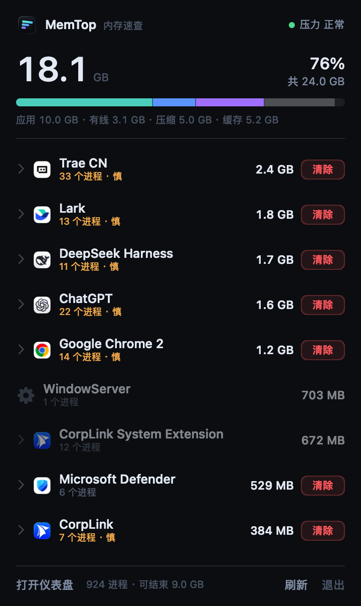
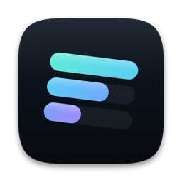
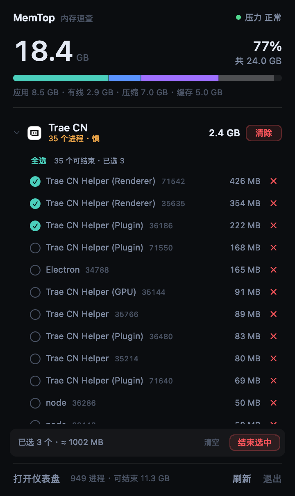
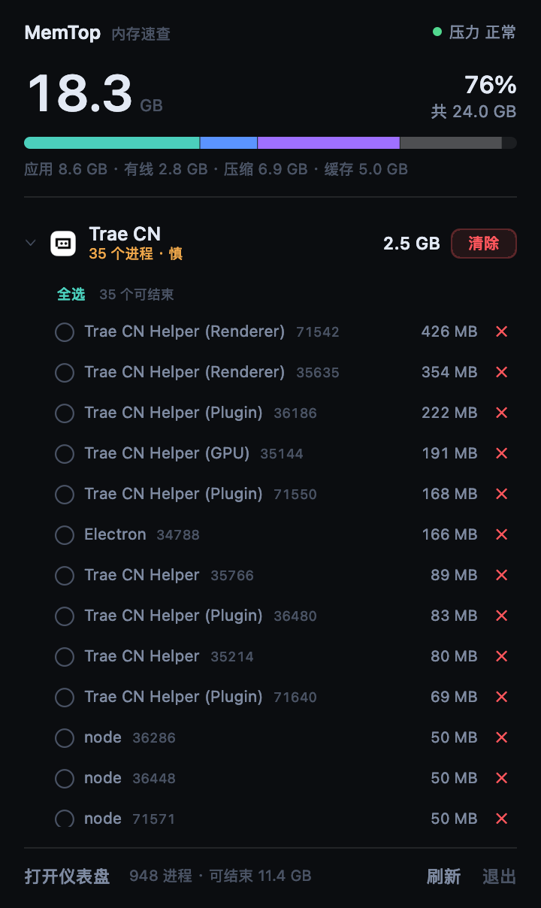

# MemTopBar — 菜单栏里的内存速查

版本二的前端：一个常驻菜单栏的原生小 App。点一下看到「谁在吃内存」，展开就能结束
某个应用，不必开终端、也不必开浏览器。



> 数据与安全规则全部复用 `memtop`，这里只做展示与交互，不重复实现判断逻辑。



## 安装

```bash
cd memtop-bar
./install.sh
open ~/Applications/MemTopBar.app
```

`install.sh` 会调用 `build.sh` 编译，并把 `MemTopBar.app` 复制到 `~/Applications`
（不需要 sudo，也不需要 Xcode 工程，只要 Command Line Tools 里的 `swiftc`）。

前提：`memtop` 已经安装到 `~/.local/bin/memtop`（`cd memtop && ./install.sh`）。
App 启动时会按下面的顺序找它：

1. 环境变量 `MEMTOP_BIN`
2. `~/.local/bin/memtop`
3. `/usr/local/bin/memtop`、`/opt/homebrew/bin/memtop`

## 交互

| 操作 | 结果 |
| --- | --- |
| 左键点菜单栏图标 | 打开 / 收起面板（面板出现在鼠标所在屏） |
| `Esc` / 点面板外 | 关闭面板 |
| 点应用行 | 展开 / 收起子进程 |
| 行尾 `清除` | **立即结束该应用全部可结束进程**（不再二次确认） |
| 展开后顶部「全选」 | 勾选该应用全部可结束进程，再点取消 |
| 子进程行首圆圈 / 点整行 | 勾选 / 取消勾选，用于批量结束 |
| 底部「结束选中」 | 立即批量结束已勾选的进程 |
| 底部「清空」 | 清空勾选 |
| 子进程行尾 `✕` | 只结束这一个进程（单次确认） |
| 右键菜单栏图标 | 打开面板 / 刷新 / 退出 |
| 底部「打开仪表盘」 | 拉起 `memtop web` 并打开浏览器 |

菜单栏标题显示 `68% 16.4G`，鼠标悬停有「已用 / 总量 / 压力」提示。
面板每 2 秒刷新；结束进程后立即刷新。

**「清除」与「结束选中」都是立即执行**：点下去直接把目标进程一次性发出去，不再弹
任何事前确认框；受保护进程自动跳过，操作照常写入 `kill.log`。

只有在“发完信号仍有进程没退出”“全部受保护”“结束失败”这类异常情况下才会弹框；
弹框期间面板会降到弹框下面一层，保证弹框完整可见、可点击。

### 全选与批量清除

展开应用后，成员列表顶部会多一行「全选 35 个可结束」：点一下勾选该应用全部可结束进程，
选中后变成「取消全选」。也可以单独点行首圆圈，或点整行来逐个勾选。

只要有勾选，面板底部就会浮出一条操作栏：

```
已选 3 个 · ≈ 1002 MB                    清空   结束选中
```

「结束选中」立即把勾选的 PID 一次性全部结束。
勾选可以跨应用保留（切换展开、面板收起再打开都不会丢），每次刷新会自动剔除已经退出的 PID。





## 图标

采用方案 B「容量条」：三条容量轨道 + 递减的用量填充，青→蓝渐变，824 超椭圆主体
（Big Sur 规格：1024 画布、柔和投影、无文字）。

- 源图：`icons/out/icon-b.png`（1024，带透明通道）
- 生成 icns：`icons/build_icns.sh out/icon-b.png` → `AppIcon.icns`（16–1024 全套）
- `build.sh` 会把 `AppIcon.icns` 复制进 `Contents/Resources`，
  `Info.plist` 的 `CFBundleIconFile = AppIcon`
- 面板左上角通过 `NSApp.applicationIconImage` 显示同一枚图标

改配色或形状：编辑 `icons/make_icons.swift` 重新渲染，再跑 `build_icns.sh` 和 `build.sh`。

## 设计说明

**为什么用 `memtop --json` 而不是在 Swift 里重新采集？**
内存口径（`phys_footprint`、压缩页、`.app` 归组、保护规则）在 CLI 里已经实现并测过，
App 只做一次 `Process` 调用 + `JSONDecoder`。这样两个前端永远看到同一份数据，
修一次口径两边都生效。

**为什么结束也走命令行？**
`memtop kill <pids> --yes` 会把操作写进 `~/.local/state/memtop/kill.log`，
并且再执行一次保护校验。App 不直接 `kill(2)`，避免绕过审计和硬保护。

**界面约束**

- 360 × 604 固定尺寸，列表区域滚动，行高 44（子进程 26）；
- 深色固定配色（不跟随系统浅色），保证在菜单栏弹出时对比度稳定；
- 应用图标用 `NSWorkspace.icon(forFile:)` 直接取，不额外打包资源；
- 受保护的应用整行降透明度、隐藏 `✕`，避免给出“可以杀”的错误暗示。

## 构建

```bash
./build.sh
# 产物：MemTopBar.app
```

编译参数：`swiftc -O -swift-version 5 -framework AppKit`，产物用 ad-hoc 签名
（`codesign -s -`），本机运行不需要开发者证书。

调试用：

```bash
# 把面板渲染成 PNG，不弹菜单栏
MemTopBar.app/Contents/MacOS/MemTopBar --snapshot /tmp/panel.png
# 顺带展开第一个应用
MemTopBar.app/Contents/MacOS/MemTopBar --snapshot /tmp/panel.png --expand 0
```

## 已知限制

- 没有做「开机自启」：需要的话在「系统设置 → 通用 → 登录项」里手动添加；
- 没有 Dock 图标（`LSUIElement`），退出要走右键菜单或面板底部「退出」；
- 未签名 + ad-hoc 签名，拷到别的机器首次打开需要右键 → 打开；
- 菜单栏标题宽度有限，只显示百分比和已用 GB，详细数字在面板里；
- App 本身不监听端口，所有结束动作都是短命子进程，不常驻后台服务。
