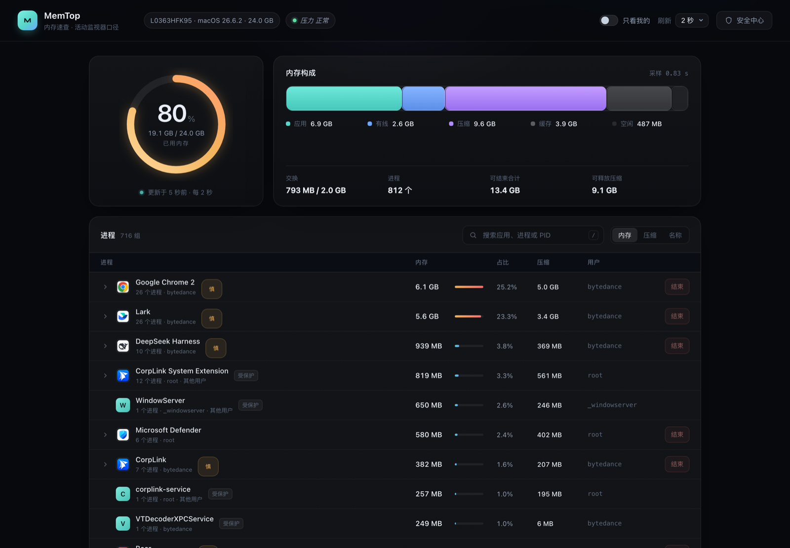
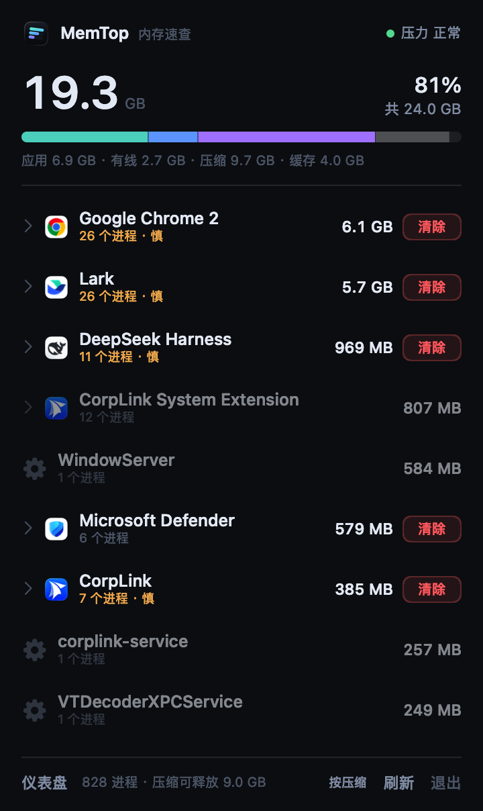
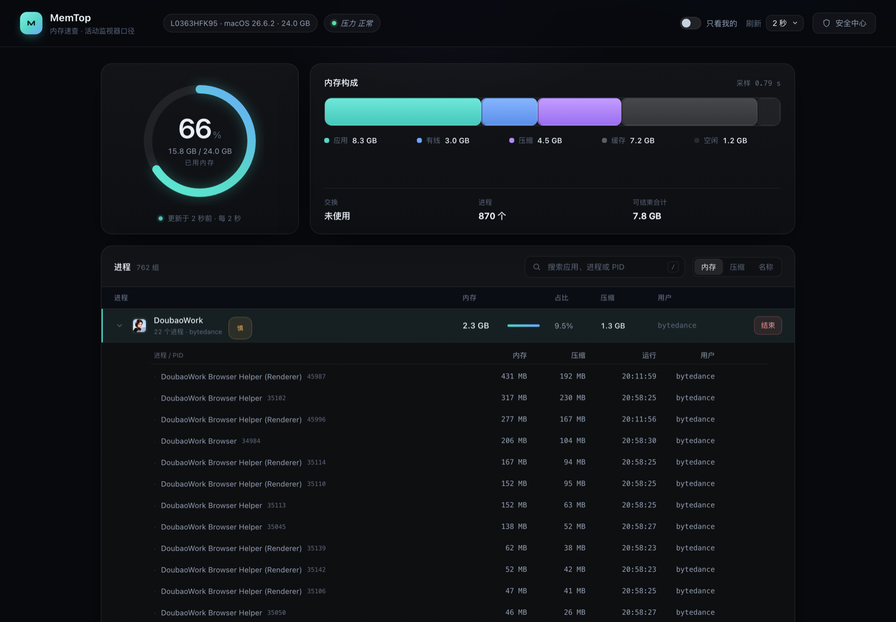
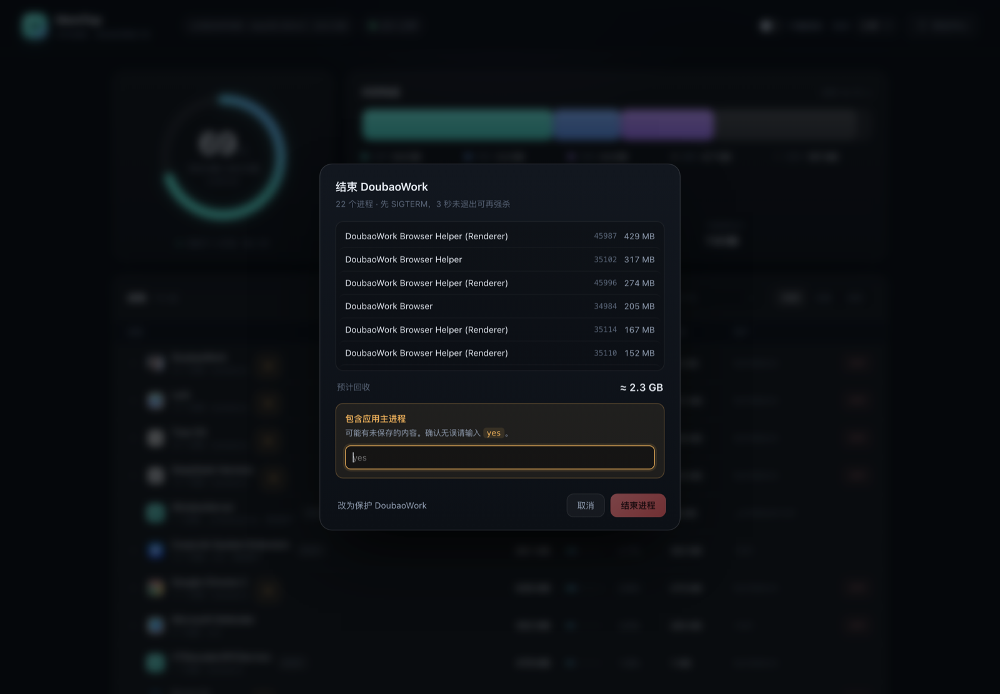
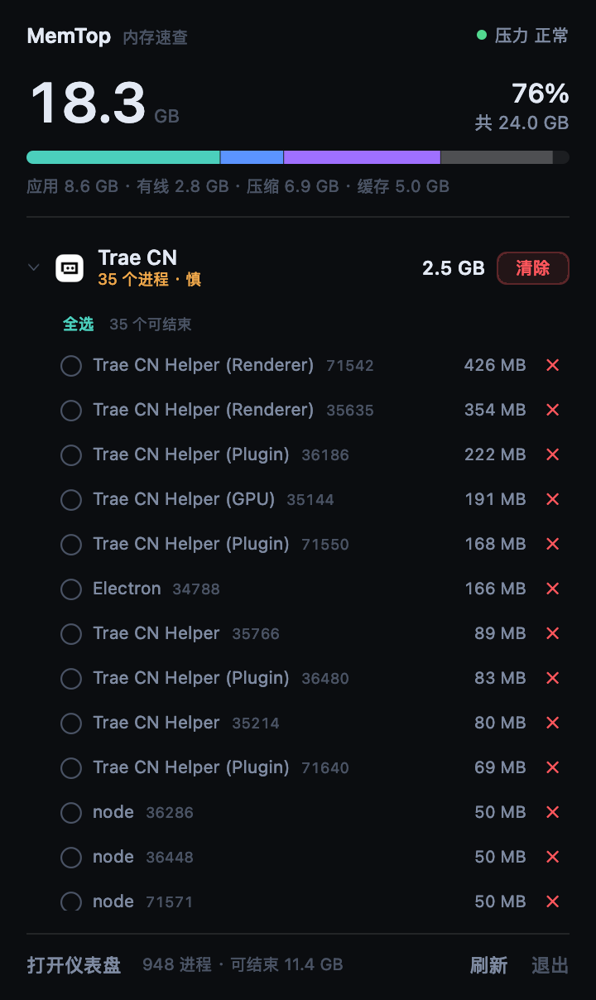

# memtop — macOS 内存速查（两个前端版本）

仿「活动监视器」的统计口径看清谁在吃内存，按应用归组、从高到低排序，并且能安全地结束
非必要进程——系统组件、当前终端会话链、其他用户的进程永远杀不到。

现在有两个前端交付形态，共用同一套采集与安全逻辑：

| | **版本一 · Web 仪表盘** | **版本二 · 菜单栏 App** |
| --- | --- | --- |
| 打开方式 | 终端 `memtop web`，浏览器打开 | 双击 `MemTopBar.app`，常驻菜单栏 |
| 适合 | 大屏分析、搜索、批量处理、看构成 | 随手瞄一眼、快速结束某个应用 |
| 形态 | 本地 HTTP 服务（仅 127.0.0.1）+ 单页前端 | 原生 AppKit，无 Dock 图标 |
| 依赖 | 无（Python 标准库） | 无（已编译，数据来自 `memtop --json`） |
| 目录 | `memtop/` | `memtop-bar/` |





## 快速开始

### 版本一：Web 仪表盘

```bash
cd memtop
./install.sh          # 安装命令行 + 前端资源到 ~/.local
memtop web            # 启动并自动打开 http://127.0.0.1:8787/
```

也可以直接双击 `memtop-web.command`。其它参数：

```bash
memtop web --port 9000     # 换端口
memtop web --no-open       # 不自动开浏览器
memtop web --interval 3    # 后台采样间隔（秒）
```

### 版本二：菜单栏 App

```bash
cd memtop-bar
./install.sh          # 编译并安装到 ~/Applications/MemTopBar.app
open ~/Applications/MemTopBar.app
```

菜单栏出现 `▤ 68% 16.4G`；点开是内存构成 + 应用列表，点某一行展开子进程，
行尾「清除」点一下立即结束该应用全部可结束进程；展开后顶部「全选」可勾选整组，
底部「结束选中」立即批量结束，子进程行尾 `✕` 则单独结束（单次确认）。
右键菜单可以打开面板 / 刷新 / 退出。底部「打开仪表盘」会自动拉起版本一并跳转浏览器。

## 版本一：Web 仪表盘



- **概览**：环形已用占比、内存构成条（应用 / 有线 / 压缩 / 缓存 / 空闲）、交换与压力；
- **列表**：应用图标 + 进程数 + 内存 + 占比 + 压缩 + 用户，点击展开每个 helper；
- **排序**：内存 / 压缩 / 名称；**搜索**：应用名、进程名、PID；**只看我的**；
- **结束**：选中行 → 确认弹窗（含预计回收、可能丢失内容的警告）→ `SIGTERM`，
  3 秒不退再提示强杀；应用主进程需要输入 `yes`；
- **安全中心**：自定义保护名单（立即生效）、最近操作记录；
- 快捷键：`/` 搜索、`j`/`k` 移动、`Enter` 展开、`x` 结束、`r` 刷新、`Esc` 关闭。



服务只监听 `127.0.0.1`，并做了三层防护：

1. 页面里注入一次性会话 token，所有写操作（`kill` / `protect`）必须带 `X-MemTop-Token`；
2. 校验 `Host` 头，阻断 DNS rebinding；不返回 CORS 头，跨站读不到数据；
3. 服务端重新采样后再判断保护状态，不信任前端传来的“可杀”标记。

接口（只读接口无需 token）：

| 方法 | 路径 | 说明 |
| --- | --- | --- |
| GET | `/api/snapshot` | 内存 + 分组 + 进程明细 |
| GET | `/api/protect` | 保护名单 |
| GET | `/api/log?limit=40` | 结束记录 |
| GET | `/api/icon?bundle=…` | 应用图标（sips 转 png 并缓存） |
| POST | `/api/kill` | `{pids, signal, grace, force, ack}` |
| POST | `/api/protect` | `{action: add/rm, pattern}` |

## 版本二：菜单栏 App



- 菜单栏常驻 `68% 16.4G`，2 秒刷新；点开是 360×604 的深色面板；
- 顶部：已用 / 总量 / 占比、构成条、压力状态；
- 列表：前 40 组，按内存降序，带应用图标；点击展开 helper，逐项或整组结束；
- 结束走同一套 `memtop kill` 命令行，因此保护规则、审计日志完全一致；
- 结束后自动刷新；`SIGTERM` 未退出会弹「强制结束」二次确认。

细节、构建方式与取舍见 [memtop-bar/README.md](../memtop-bar/README.md)。

## 命令行 / TUI

```
memtop                      # 交互界面（默认）
memtop -1 --limit 15        # 打印一次快照
memtop pressure             # 只看内存概况
memtop kill @Chrome         # 结束整个 Chrome 组（会先问）
```

### TUI 界面

```
 memtop  内存 24.0 GB · 已用 16.9 GB (70%) · 压缩 2.6 GB · 缓存 6.3 GB · 交换 0 B · 压力 正常
 ██████████████████████████████████████████████░░░░  应用 11.4 GB  有线 2.9 GB  压缩 2.6 GB  缓存 6.3 GB
    内存      占比    压缩      PID    进程                            标记
▸ 3.2 GB    19.1%   992 MB    34803  DoubaoWork  (23)                 应用
▸ 1.3 GB    8.0%    312 MB    35635  Trae CN  (25)                    应用
▸ 563 MB    3.3%    71.0 MB   34315  WindowServer                     受保护
```

按键：

| 键 | 作用 |
| --- | --- |
| `↑` `↓` / `j` `k` | 移动 |
| `Enter` / 空格 | 展开 / 收起应用分组 |
| `x` | 结束选中项（分组行 = 结束该应用全部可结束的子进程） |
| `/` | 按名称过滤 |
| `s` | 切换排序：内存 → 压缩 → 名称 |
| `r` | 立即刷新 |
| `p` | 查看受保护名单 |
| `?` | 帮助 |
| `q` / `Esc` | 退出（有过滤时 `Esc` 先清过滤） |

## 为什么不用 `ps` 的 RSS

活动监视器「内存」列显示的是 **phys_footprint（物理足迹）**，它包含被压缩的内存；
而 `ps` 的 RSS 只算常驻页，压缩过的部分完全看不到。结果就是：一个吃满内存的浏览器，
`ps` 里可能只有几百 MB，活动监视器里却是几个 GB。

memtop 统一用 `top` 的 MEM 列（同为 phys_footprint），并且用 `proc_pidpath` 拿到精确的
可执行路径（对 root 进程同样有效，不需要 sudo），再按 `.app` 归属把 helper / renderer
归到同一个应用下——和活动监视器的分组视图一致。

## 安全模型

结束进程是破坏性操作，memtop 的默认行为是「能杀、但很难误杀」：

**永久不可结束（硬保护）**

- PID 0 / 1、`launchd`、`WindowServer`、`Finder`、`Dock`、`loginwindow`、
  `coreaudiod`、`securityd`、`tccd`、`mds*`、`syspolicyd` 等关键系统进程；
- 路径在 `/System/`、`/usr/libexec/`、`/Library/Apple/`、`/usr/sbin/`、`/sbin/` 下的系统组件；
- **当前会话的祖先进程**——跑 memtop 的终端、tmux、DeepSeek Harness 等，
  杀它们等于杀掉你自己，所以永远拒绝；
- 其他用户的进程默认保护（`--allow-root` 可放开，但硬保护项仍然拒绝）。

**二次确认**

- 后台/helper 进程：`y/N` 确认（Web 里是一次点按确认）；
- 应用主进程（Chrome、Trae、Lark…）：必须输入 `yes`，因为可能丢失未保存内容；
- 先发 `SIGTERM`，3 秒后仍存活再问是否 `SIGKILL`；
- 命令行默认只是预览，`--yes` 才真正执行，`--dry-run` 只看计划。

**可审计 / 可自定义**

所有实际发出的信号追加到 `~/.local/state/memtop/kill.log`（JSON Lines）。
`memtop protect add "Google Chrome"` 会把规则写进 `~/.config/memtop/protect.txt`，
支持 `*` 通配；同时匹配进程名和所属 `.app` 名，所以能覆盖到 helper 进程。

## 统计口径

| 指标 | 计算方式 |
| --- | --- |
| 已用 | 匿名页 + 有线页 + 压缩页 |
| 应用 | `Anonymous pages` |
| 有线 | `Pages wired down` |
| 压缩 | `Pages occupied by compressor` |
| 缓存 | `File-backed pages`（系统可回收，不计入已用） |
| 压力 | `kern.memorystatus_vm_pressure_level`：1 正常 / 2 警告 / 4 严重 |
| 进程内存 | `phys_footprint`（top 的 MEM 列），不是 RSS |
| 可释放压缩 | 可结束进程当前占用的压缩页合计 |

压缩内存由内核管理，用户态没有“解压释放”的接口；结束进程才会回收其压缩页。
Web 概览里的「可释放压缩」就是这个上限，点图例中的「压缩」可直接按压缩占用排序。

「进程足迹合计」会大于「已用」：共享库、共享内存会被每个进程各算一次，
活动监视器也是同样的情况。所以「预计回收」只是上限，真实释放量通常更小。

## 已知取舍

- `top` 的 MEM 以 1 MB 取整，排序足够，别拿它对账。
- 采样一次约 0.5 秒（`top` 本身的开销），两个前端默认 2 秒刷新一次。
- 非当前用户的进程默认受保护；`--allow-root` 只解除保护标记，普通用户向 root 进程
  发信号仍然会失败（真要杀得用 `sudo memtop`，不建议）。
- 结束应用主进程不会保存文档，确认框里的警告请当真。
- Web 服务是本地单用户工具：没有登录体系，靠 loopback + token 保护；
  不要把端口转发到公网。
